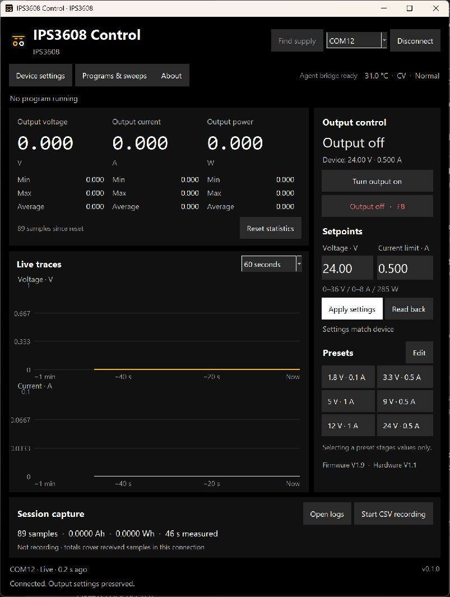
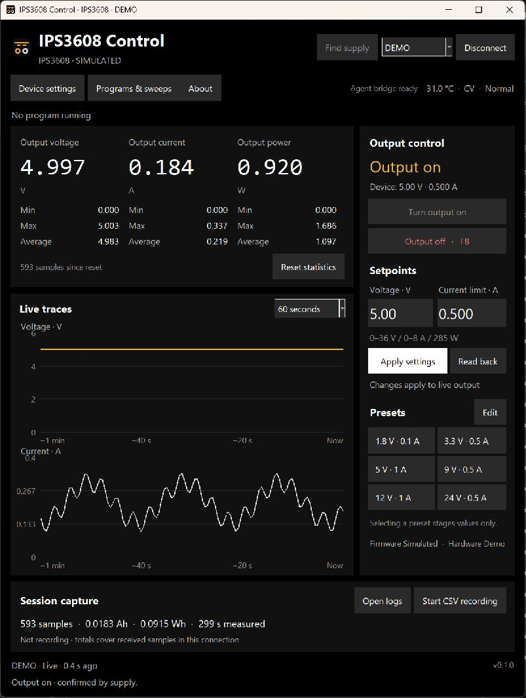

# IPS3608 Control

**A desktop workbench for your FNIRSI power supply.**

Set voltage and current limits, watch a load over time, record measurements,
and run repeatable sequences from your computer. Supports **IPS3608, DPS-150
and DPS-150P**, with automatic model detection and a local MCP interface for
AI-assisted bench work.

[Windows releases](https://github.com/brandonjank/ips3608-control/releases) ·
[User guide](docs/usage.md) · [MCP setup](docs/mcp.md) · [Engineering](docs/architecture.md)



## What you can do

- **Adjust a live output.** Apply voltage/current limits with output on or off;
  output switching remains a separate action. Changes require device readback.
- **Measure a session.** Separate voltage/current plots, resettable V/A/W
  minimum, maximum and average, CSV recording, and integrated Ah/Wh estimates.
- **Repeat a test.** Timed steps, cycles, voltage/current sweeps, pause/resume,
  and explicit finish behavior. Review the steps before execution.
- **Manage device settings.** Six stored presets, protection thresholds,
  brightness and metering, using the connected model's limits.
- **Give an agent the same controls.** A 21-tool local MCP server shares the
  desktop app's serial worker, validation and confirmation path.
- **Try it without hardware.** A labelled demo simulates the device in memory;
  it never opens a serial port.

## Get started

### Windows portable app

1. Download the `IPS3608-Control-…-windows-x64.zip` asset from
   [Releases](https://github.com/brandonjank/ips3608-control/releases).
2. Extract the **whole folder**, then open **IPS3608Control.exe**. Python is
   included; keep the `_internal` folder alongside the executables.
3. Power the supply normally, connect its **USB data port**, select the port
   and click **Connect**. The app reads the model and existing settings.
4. Edit voltage/current and click **Apply settings**. Enable output separately
   when you intend to power the load. **F8** requests output off while the app
   has focus.

The portable build is unsigned. Release assets include SHA-256 checksums and
third-party license notices. You can also build or run the source below.

### Run from source

Use Python **3.10+ with Tcl/Tk**. Windows is the supported desktop platform.

```powershell
git clone https://github.com/brandonjank/ips3608-control.git
cd ips3608-control
py -3 -m venv .venv
.\.venv\Scripts\python.exe -m pip install -e ".[agent]"
.\.venv\Scripts\python.exe -m ips3608.app
```

Or run **Setup.cmd**, then **Launch Bench Control.cmd**.

To explore without a supply:

```powershell
.\.venv\Scripts\python.exe -m ips3608.app --demo
```

The packaged app also accepts `--demo`, optionally followed by `DPS-150` or
`DPS-150P`. Connect to **DEMO** in that window. Its title and MCP status remain
marked as simulated; every command stays inside the simulator.



## Device support

| Model | Rated output | Verification |
| --- | --- | --- |
| IPS3608 | 36 V / 8 A / 285 W | Hardware V1.1; firmware V1.3 and V1.9 |
| DPS-150 | 30 V / 5 A / 150 W | Protocol evidence and simulated device; physical testing needed |
| DPS-150P | 30 V / 5 A / 150 W | Protocol evidence and simulated device; physical testing needed |

Live writes respect lower device-reported ceilings. DPS supplies also reserve
0.2 V of input headroom. DPS-150P readings use µA/mA/A where helpful; the
current-limit setting resolution remains **1 mA**. Unknown identities are
rejected even if they share the same USB identifier.

This is a **first public beta** and an independent project, not affiliated
with or endorsed by FNIRSI. See [compatibility evidence](docs/model-compatibility.md)
and [validation](VALIDATION.md) before relying on a new model or firmware.

## AI and automation

The optional **IPS3608ControlMCP.exe** provides stdio MCP. Keep the desktop app
open; it remains the sole serial-port owner. Source installs provide the
`ips3608-mcp` command. The included `$ips3608-control` skill describes units,
readback, output behavior and program controls.

> “Monitor for ten seconds and report the voltage, current and power range.”
>
> “Set the current limit to 0.25 A; keep voltage and output unchanged.”

See [MCP configuration and tool reference](docs/mcp.md). No cloud relay or
external API key is required by the controller.

## Output behavior worth knowing

Connecting, disconnecting and closing the app **preserve physical output**.
Applying setpoints changes an active output immediately. Pause holds the
current output; stopping a program requests output off. A lost USB connection
cannot guarantee shutdown. The supply's own output button remains available
after releasing remote control.

There are no firmware-flashing, calibration or guessed fan-control commands.
Read the [user guide](docs/usage.md) for detailed behavior and limitations.

Settings and recordings live under `%LOCALAPPDATA%\IPS3608Control` on Windows,
outside the install folder. `IPS3608_CONTROL_HOME` can select a separate data
directory for testing or a second isolated demo.

## Development

```powershell
.\.venv\Scripts\python.exe -m pip install -e ".[dev]"
.\.venv\Scripts\python.exe -m unittest discover -s tests -v
```

Tests use simulated serial devices; they do not need or operate a physical
supply. The suite covers packets, limits, readback, stale data, output behavior,
programs, recording, the native UI and actual MCP stdio/loopback requests.

[Build a release](docs/releasing.md) · [Contribute](CONTRIBUTING.md) ·
[Protocol notes](docs/protocol-notes.md) · [Firmware research](docs/firmware-investigation.md)

## License and acknowledgements

[MIT](LICENSE) · Copyright © 2026 Brandon Jank.

Thanks to the community protocol work in
[Balu46/FNIRSI_control](https://github.com/Balu46/FNIRSI_control),
[alexgavs/newfnrs](https://github.com/alexgavs/newfnrs),
[hamsternz/fnirsi_psu](https://github.com/hamsternz/fnirsi_psu), and
[burgerwdev/fnrisi-power-supply-webcon](https://github.com/burgerwdev/fnrisi-power-supply-webcon).
Dependencies retain their own licenses; see [third-party notes](THIRD_PARTY.md).
