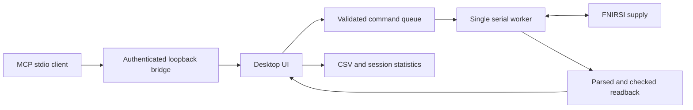

# Architecture

The main constraint is physical output: a button, an automation step and an
agent must not compete for the serial port or disagree about what succeeded.

`protocol.py` handles framing, checksums, register decoding and command
validation. `models.py` supplies rated and effective live limits. `device.py`
owns the serial connection, prioritizes explicit off, rejects stale writes and
waits for matching device responses. Queued targets are checked again when
dispatched, after any newly received limit updates.

`app.py` owns Tk state. Serial and IPC threads post events or requests; they
do not manipulate widgets. `programs.py` is a deterministic execution state
machine: holds begin after readback, pause freezes time, and finish behavior is
explicit. Recording, statistics and energy integration have separate reset
scopes.

`mcp_server.py` exposes typed tools and resources over stdio. It communicates
with the open desktop through `agent_bridge.py`; it never opens USB itself.
The bridge uses a random loopback port and credential, expiring queued
requests, and the same GUI/serial confirmation events as manual controls.

`demo.py` provides an in-memory serial implementation. It is selected explicitly
with `--demo`, is marked in the title and MCP status, and never delegates to
pyserial. It exercises the normal worker and UI without attached hardware.

`paths.py` separates package resources from writable per-user data. Source and
packaged GUI/MCP entry points discover the same local endpoint. Windows builds
ship a windowed GUI and a separate console/stdio MCP executable sharing one
dependency folder.

The UI renders zeros as measured zeros, unknown output as unknown, and old
values as stale. Setpoint writes are sequential device commands rather than
an atomic transaction; reduced current is sent first when appropriate. These
are host-timed bench sequences, not a precision waveform generator.
